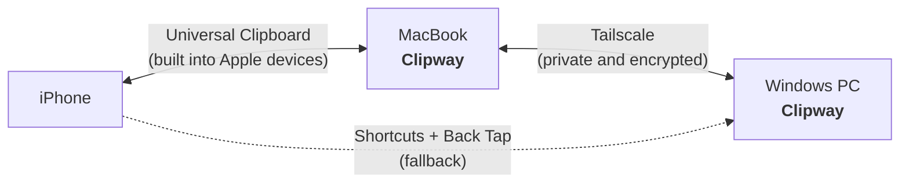

# Clipway

**One clipboard across all your devices.**

A fast, good-looking clipboard manager for Windows and macOS that syncs with your iPhone.
Press a shortcut, find anything you copied, and paste it anywhere.

[Roadmap](ROADMAP.md) · [Architecture](docs/ARCHITECTURE.md)

---

## Why

Apple's Universal Clipboard is great until it stops working, and it never reaches Windows.
The Windows clipboard (`Win + V`) works everywhere but isn't pleasant to use.

Clipway combines what's good about both:

- **A clipboard history you'll want to open.** It's quick, searchable, and keeps text, links, and images.
- **Everything stays on your devices.** There's no account and no cloud server, and nothing is stored on someone else's machine.
- **Sync that works away from home.** Devices connect through your own private [Tailscale](https://tailscale.com) network.
- **Free.** It's built only from free tools.

## How it works

1. **Copy anything** on any device, and Clipway saves it to a local history.
2. **Press `Ctrl/Cmd + Shift + V`**: a popup opens where you search and pick an item to paste.
3. **Your other devices get it too.** The Mac acts as a bridge to the iPhone through Apple's own Universal Clipboard, so the phone needs no extra keyboard or app.

## Planned features

| | |
|---|---|
| **Popup on a hotkey** | Opens at your cursor and closes when you're done |
| **Rich history** | Text, links, images, and colors, each with a preview |
| **Instant search** | Type to filter, then press Enter to paste |
| **Pins** | Keep the snippets you use most at the top |
| **Privacy** | Skips content copied from password managers |
| **Cross-device sync** | Mac ⇄ Windows over Tailscale, iPhone through the Mac |
| **Works offline** | Copies made while a device is offline sync when it's back |

## Tech stack

- **[Tauri 2](https://tauri.app)**: one app for Windows and macOS, with the UI in web tech and system access in Rust
- **React + TypeScript**: the popup UI
- **SQLite**: local clipboard history
- **[Tailscale](https://tailscale.com)**: private network linking your devices, wherever they are

## Status

Clipway is in the **planning phase**. Progress is tracked in the [roadmap](ROADMAP.md) and in the [milestones](../../milestones).

## License

[MIT](LICENSE)
