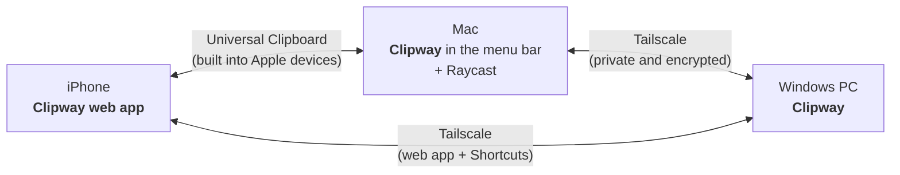

# Clipway

**One clipboard across all your devices.**

A good-looking clipboard manager for Windows that syncs with your Mac and iPhone.
Copy on any device and find it on the others for the next 24 hours.

[Roadmap](ROADMAP.md) · [Architecture](docs/ARCHITECTURE.md)

---

## Why

Apple's Universal Clipboard is great until it stops working, it forgets what you copied after about 2 minutes, and it never reaches Windows.
The Windows clipboard (`Win + V`) works everywhere but isn't pleasant to use.

Clipway combines what's good about both:

- **A clipboard history you'll want to open.** It's quick, searchable, and keeps text, links, and images.
- **Nothing vanishes after 2 minutes.** Items copied on the iPhone are saved the moment they reach the Mac.
- **A short memory on purpose.** History only covers the last 24 hours, then it's deleted.
- **Everything stays on your devices.** There's no account and no cloud server, and nothing is stored on someone else's machine.
- **Sync that works away from home.** Devices connect through your own private [Tailscale](https://tailscale.com) network.
- **Free.** It's built only from free tools.

## How it works

1. **Copy anything** on any device, and Clipway saves it for 24 hours.
2. **Find it again:** press `Ctrl + Shift + V` on Windows, open Raycast's Clipboard History on the Mac, or open the Clipway web app on the iPhone.
3. **Your other devices get it too.** Computers sync over Tailscale. The iPhone's web app talks to whichever computer is on, and when the Mac is nearby, Apple's Universal Clipboard moves items with no taps at all.

## Planned features

| | |
|---|---|
| **Popup on a hotkey** | On Windows, opens at your cursor and closes when you're done |
| **Raycast on the Mac** | Clipway runs quietly in the menu bar, and Raycast stays your clipboard UI |
| **iPhone web app** | Your last 24 hours from every device, tap to copy, and a button to send |
| **Rich history** | Text, links, images, and colors, each with a preview |
| **Instant search** | Type to filter, then press Enter to paste |
| **24-hour history** | Everything older than a day is deleted automatically |
| **Privacy** | Skips content copied from password managers |
| **Works offline** | Copies made while a device is offline sync when it's back |

## Tech stack

- **[Tauri 2](https://tauri.app)**: the Windows app and the Mac menu bar agent, from one codebase, with the UI in web tech and system access in Rust
- **React + TypeScript**: the Windows popup and the iPhone web app
- **SQLite**: the local 24-hour history
- **[Raycast](https://raycast.com)**: the clipboard UI on the Mac
- **[Tailscale](https://tailscale.com)**: private network linking your devices, wherever they are

## Status

Clipway is in the **planning phase**. Progress is tracked in the [roadmap](ROADMAP.md) and in the [milestones](../../milestones).

## License

[MIT](LICENSE)
