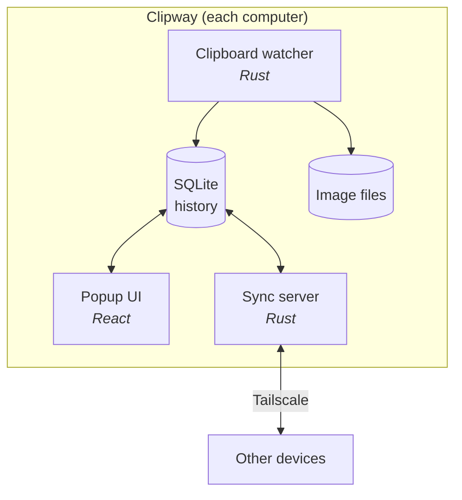

# Architecture

## Overview



| Part | What it does |
|---|---|
| **Clipboard watcher** | Listens for clipboard changes, works out the content type, skips sensitive content |
| **Storage** | SQLite holds item metadata and text; images live as files next to it |
| **Popup UI** | Web view opened by a global shortcut; search, preview, paste |
| **Sync server** | Sends new items to paired devices over the Tailscale network |

## Why these choices

**Tauri instead of Electron.** It ships the OS's own web view instead of a whole copy of Chromium. The app is a few MB instead of 150+, and it uses much less memory, which matters for something that runs all day.

**Tailscale instead of a cloud server.** Tailscale links devices into a private, encrypted network (WireGuard) that works from anywhere. Devices talk to each other directly, so there's no server to host or pay for, and clipboard data never sits on someone else's machine.

**The Mac as the iPhone bridge.** iOS doesn't let apps read the clipboard in the background. The usual workarounds (custom keyboards, paste prompts) are annoying to use. Apple's Universal Clipboard already moves content between the iPhone and Mac with no friction, so Clipway on the Mac relays it on to Windows.

## Synced item format

```json
{
  "id": "uuid",
  "origin": "device-id",
  "kind": "text | link | image | color",
  "content": "... or image hash",
  "createdAt": "2026-10-17T12:00:00Z"
}
```

`id` and `origin` stop items from bouncing back and forth between devices.
