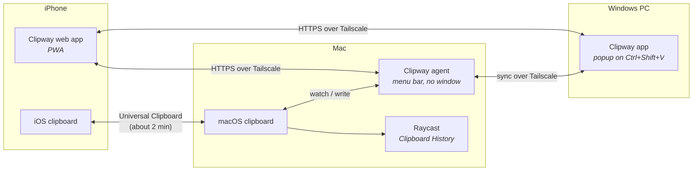
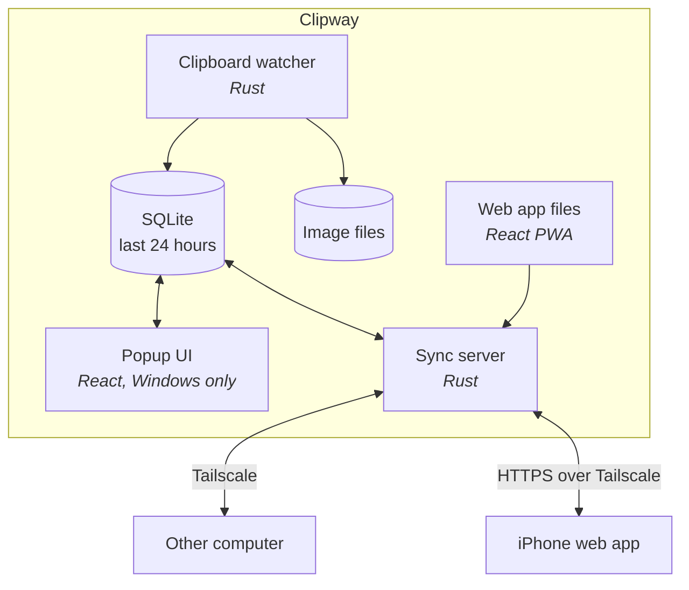

# Architecture

## Devices



| Device | Clipway runs as | UI |
|---|---|---|
| **Windows PC** | Tauri app in the system tray | Clipway popup |
| **Mac** | The same Tauri app, in the menu bar with no window | Raycast's Clipboard History |
| **iPhone** | Web app served by whichever computer is online | The web app, plus Back Tap Shortcuts |

## Inside Clipway (same code on Windows and Mac)



| Part | What it does |
|---|---|
| **Clipboard watcher** | Notices clipboard changes (an event on Windows, a check about 4 times a second on the Mac), works out the content type, skips sensitive content, and reads Universal Clipboard items right away |
| **Storage** | SQLite holds item metadata and text, images live as files next to it, and anything older than 24 hours is deleted |
| **Popup UI** | Windows only (off by default on the Mac, where Raycast is the UI): a web view opened by a global shortcut to search, preview, and paste |
| **Sync server** | Sends new items to the other computer and serves the iPhone web app and its API, reachable only through Tailscale |
| **iPhone web app** | Shows the last 24 hours from all devices, copies an item with a tap, and sends the iPhone clipboard |

## Keeping Universal Clipboard items past 2 minutes

When you copy on the iPhone, Universal Clipboard offers the item to your Mac for about 2 minutes. The content stays on the phone until something on the Mac asks for it, and after 2 minutes the offer expires.

Clipway's Mac agent asks right away:

1. It checks the Mac clipboard about 4 times a second.
2. When an item from the iPhone shows up (marked `com.apple.is-remote-clipboard`), it reads the full content immediately, which pulls it over from the phone.
3. It saves the item to its own history, labelled "iPhone". From then on it's a normal item: it syncs to Windows and shows in the iPhone web app for 24 hours.

It works the same way in reverse: items from Windows go on the Mac clipboard, Universal Clipboard offers them to the iPhone for about 2 minutes, and the web app keeps them for 24 hours.

**What has to be set up**

| Requirement | Notes |
|---|---|
| Universal Clipboard working between the Mac and iPhone | Phase 0 checklist in the [roadmap](../ROADMAP.md) |
| Clipway agent running on the Mac and starting at login | Built in Phase 2 |
| The Mac awake when you copy on the iPhone | If it's asleep, the item never reaches it and can't be saved. Whether a locked screen is enough is a Phase 0 test. On a MacBook, the "Prevent automatic sleeping on power adapter when the display is off" option (*System Settings → Battery → Options*) keeps it awake while plugged in |
| The iPhone near the Mac, on the same Apple Account | Universal Clipboard uses Bluetooth to find the other device |
| Tailscale on the Mac, PC, and iPhone, with MagicDNS and HTTPS certificates turned on | Needed for the web app |

When the Mac isn't around, Universal Clipboard can't work at all. The web app's "Send clipboard" button and the Back Tap Shortcut cover that case; they go straight to whichever computer is online.

## 24-hour history

- An item is deleted 24 hours after it was last copied. Copying the same thing again moves it to the top and restarts its 24 hours.
- The clock follows the time of the copy on the original device, so a synced item doesn't live longer because it arrived late.
- Deleting removes the database row and any image file. It runs at startup and every minute.
- Items still waiting in the outbox are dropped once they're 24 hours old.
- The iPhone web app stores nothing on the phone.
- Raycast keeps its own copy of everything that lands on the Mac clipboard, under its own Clipboard History retention setting.

## Why these choices

**Tauri instead of Electron.** It ships the OS's own web view instead of a whole copy of Chromium. The app is a few MB instead of 150+, and it uses much less memory, which matters for something that runs all day.

**Tailscale instead of a cloud server.** Tailscale links devices into a private, encrypted network (WireGuard) that works from anywhere. Devices talk to each other directly, so there's no server to host or pay for, and clipboard data never sits on someone else's machine.

**Raycast as the Mac UI, not a Raycast-only Mac app.** Raycast's Clipboard History is already a good clipboard UI, so Clipway doesn't build a second one on the Mac. A Raycast extension can't replace the background part, though: Raycast starts extensions on demand or on a schedule (at most every 10 seconds) and stops them after a timeout, and its API has no way to watch the clipboard or run a server ([background refresh](https://developers.raycast.com/information/lifecycle/background-refresh), [clipboard API](https://developers.raycast.com/api-reference/clipboard)). Clipway needs something always running on the Mac to catch iPhone items within their 2 minutes, receive items from Windows, and serve the iPhone web app. That's the same Tauri app with its window turned off, so the Mac costs little extra code. Because the agent puts items from Windows on the Mac clipboard, they show up in Raycast's history on their own. A Raycast extension only makes sense later, for things the built-in history can't do, such as showing which device an item came from.

**A web app (PWA) for the iPhone.** iOS doesn't let any app, native or web, read the clipboard in the background, so a native app wouldn't capture more than a web app. A native app would also need full Xcode and either re-signing every 7 days or a $99/year developer account. The web app is served by the computers themselves, reuses the popup's React code, and talks to Windows directly, so the iPhone doesn't depend on the Mac. iOS only gives clipboard access to pages on HTTPS, and a plain Tailscale address (`http://100.x.y.z`) doesn't count. `tailscale serve` gives each computer a real certificate at `https://<machine>.<tailnet>.ts.net`, reachable only from your own devices. Certificate names appear in public logs, so pick machine names you don't mind being seen.

**The Mac as an extra bridge.** Universal Clipboard moves content between the iPhone and the Mac with no taps at all, so Clipway on the Mac saves what arrives and passes it on. It only works when the Mac is nearby and awake, which is why it sits on top of the web app instead of replacing it.

## Synced item format

```json
{
  "id": "uuid",
  "origin": "device-id",
  "via": "copy | universal-clipboard | web-app | shortcut",
  "kind": "text | link | image | color",
  "content": "... or image hash",
  "copiedAt": "2026-10-17T12:00:00Z"
}
```

`id` and `origin` stop items from bouncing back and forth between devices. `via` records how the item entered Clipway, so bridged items aren't forwarded twice. Every device deletes the item 24 hours after `copiedAt`.
